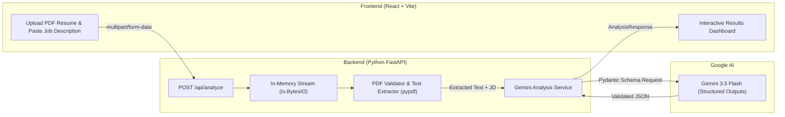

# JobFit AI — AI-Powered Resume & Job Description Analyzer

[](https://fastapi.tiangolo.com)
[](https://www.python.org/)
[](https://react.dev/)
[](https://vitejs.dev/)
[](https://ai.google.dev/)
[](LICENSE)

An asynchronous, full-stack AI application that analyzes technical resumes against job descriptions. Built with a **React (Vite)** frontend, a **Python FastAPI** backend, and the official **Google Gen AI SDK**, JobFit AI extracts, maps, and critiques role alignment with structured, evidence-backed feedback.

---

## Key Features

* **Evidence-Based Skill Matching:** Identifies overlapping skills and requires direct quotes or context from the resume to substantiate each match.
* **Transparent AI Score:** Delivers a 0–100 alignment estimate accompanied by an explicit disclaimer stating it is an educational preparation metric, not a proprietary ATS algorithm.
* **Gap Identification:** Categorizes missing competencies as *Required* or *Preferred*, providing actionable advice on how to address them.
* **Resume Bullet Tailoring:** Generates before-and-after bullet rewrites with measurable metrics and action verbs.
* **Targeted Interview Prep:** Formulates role-specific technical and behavioral questions targeting both candidate strengths and identified gaps.
* **Privacy-First In-Memory Processing:** Resumes are processed strictly in memory streams (`io.BytesIO`) and discarded after HTTP response delivery. Zero files or candidate PII are written to disk or logs.

---

## Architecture Overview



---

## Tech Stack

| Layer | Technology | Purpose |
|---|---|---|
| **Frontend** | React 18, Vite | Component-based, responsive SPA with instant hot-reloading |
| **Backend** | Python 3.12, FastAPI | Asynchronous REST API with automatic OpenAPI documentation (`/docs`) |
| **Data Validation** | Pydantic v2 | Strict schema definition and runtime validation for AI responses |
| **PDF Processing** | `pypdf` | Pure-Python, in-memory PDF parsing with zero system binary dependencies |
| **AI / LLM Engine** | Google Gen AI SDK (`google-genai`) | Structured JSON extraction using `gemini-3.5-flash` |
| **Testing** | `pytest`, `httpx`, Node.js `node:test` | Automated unit and integration testing without live API quota costs |

---

## Input Validation & Privacy Design

* **Zero Disk Persistence:** Uploaded PDF bytes are read into an `io.BytesIO` buffer, parsed in memory, and immediately garbage-collected. No temporary or persistent files are created.
* **File Constraints:** Enforces `.pdf` extension, `application/pdf` MIME validation, and a maximum size of **5 MB** (rejecting oversized files with HTTP `413`).
* **Scanned/Image PDF Detection:** If extracted text is fewer than **100 characters**, the backend returns HTTP `400` with clear guidance that scanned or image-only PDFs are unsupported.
* **Job Description Guardrail:** Requires a minimum of **50 characters** before processing to prevent unnecessary LLM invocation.
* **Sanitized Error Logging:** All exceptions pass through redaction helpers (`_sanitize_error`) to guarantee API keys, credentials, and internal stack traces are never exposed in responses or server logs.

---

## Prerequisites

* **Operating System:** Windows, macOS, or Linux
* **Python:** 3.12 or higher
* **Node.js:** v18.0.0 or higher (v20+ recommended)
* **Google Gemini API Key:** Free tier from [Google AI Studio](https://aistudio.google.com/)

---

## Local Setup Instructions (Windows PowerShell)

### 1. Clone & Project Directory
```powershell
cd E:\Job-Fit
```

---

### 2. Backend Setup

Open a PowerShell terminal for the backend:

```powershell
# Navigate to the backend directory
cd E:\Job-Fit\backend

# Create a virtual environment using Python 3.12
py -3.12 -m venv .venv

# Activate the virtual environment
Set-ExecutionPolicy -Scope Process -ExecutionPolicy RemoteSigned
.\.venv\Scripts\Activate.ps1

# Install minimal backend dependencies
pip install -r requirements.txt

# Set up environment variables
Copy-Item .env.example .env
```

Open `E:\Job-Fit\backend\.env` in an editor and insert your Gemini API key:
```env
GEMINI_API_KEY=your_actual_gemini_api_key_here
GEMINI_MODEL=gemini-3.5-flash
HOST=127.0.0.1
PORT=8000
CORS_ORIGINS=http://localhost:5173,http://127.0.0.1:5173
```

Start the FastAPI backend server:
```powershell
uvicorn app.main:app --reload --port 8000
```
* **Backend API:** `http://127.0.0.1:8000`
* **Interactive OpenAPI Docs:** `http://127.0.0.1:8000/docs`
* **Health Check:** `http://127.0.0.1:8000/health`

---

### 3. Frontend Setup

Open a second PowerShell terminal for the frontend:

```powershell
# Navigate to the frontend directory
cd E:\Job-Fit\frontend

# Install minimal frontend dependencies
npm install

# Configure environment variables
Copy-Item .env.example .env
```

Start the Vite development server:
```powershell
npm run dev
```
* **Application UI:** `http://localhost:5173`

---

## Testing & Quality Assurance

All automated tests use mocks to verify behavior without consuming Gemini API tokens or requiring real credentials.

### Run Backend Tests (`pytest`)
From an activated backend terminal:
```powershell
cd E:\Job-Fit\backend
$env:PYTHONPATH = "E:\Job-Fit\backend"
pytest -v tests
```
*Runs 24 tests covering health endpoints, PDF validation (corrupt, empty, encrypted, oversized), Gemini client schemas, and API integration paths.*

### Run Frontend Tests (`node:test`)
From the frontend terminal:
```powershell
cd E:\Job-Fit\frontend
npm test
```
*Runs native Node unit tests verifying FormData construction, boundary handling, and error response formatting.*

### Run Frontend Production Build
```powershell
cd E:\Job-Fit\frontend
npm run build
```
*Verifies asset optimization, tree-shaking, and clean production bundle creation.*

---

## Current Limitations

1. **AI-Estimated Scoring:** The match score reflects an LLM evaluation of text alignment, semantic relevance, and keyword context. It is designed for educational guidance and does not emulate proprietary commercial ATS algorithms or guarantee hiring decisions.
2. **Text-Searchable PDFs Only:** Resumes exported directly from Word, Google Docs, LaTeX, or code editors are supported. Scanned, flattened images or handwritten documents without embedded text layers require OCR and will be rejected with an actionable error.
3. **Stateless Prototype:** The current release intentionally omits user accounts, persistent storage, or historical submission records to maximize candidate privacy.

---

## Future Improvements

* **Rate Limiting & Abuse Prevention:** Integrate `slowapi` or Cloudflare reverse-proxy rate limiting before public multi-user deployment.
* **Optical Character Recognition (OCR):** Add `tesseract` fallback extraction for legacy scanned PDF resumes.
* **Exportable Analysis Reports:** Allow candidates to download tailored recommendations and interview questions as a structured PDF or Markdown summary.
* **Multi-Format Ingestion:** Extend file validation to support `.docx` and plain `.txt` inputs alongside PDF.

---

## License

This project is licensed under the MIT License — see the [LICENSE](LICENSE) file for details.
